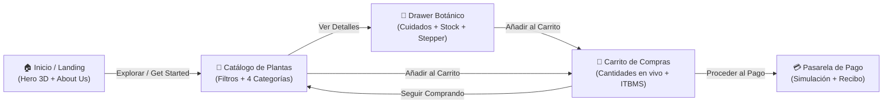
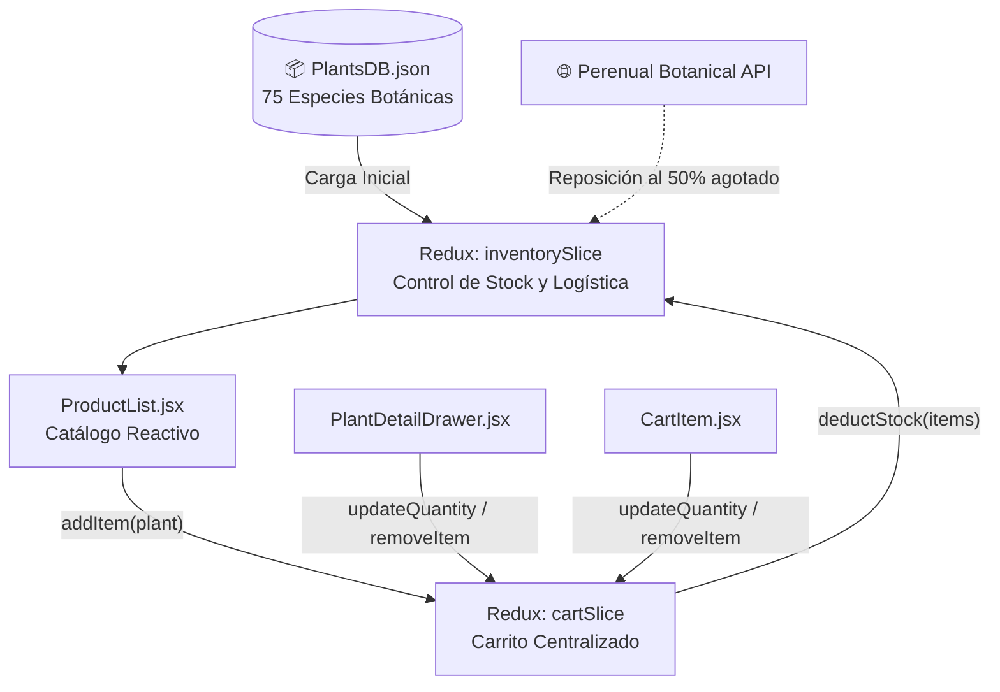
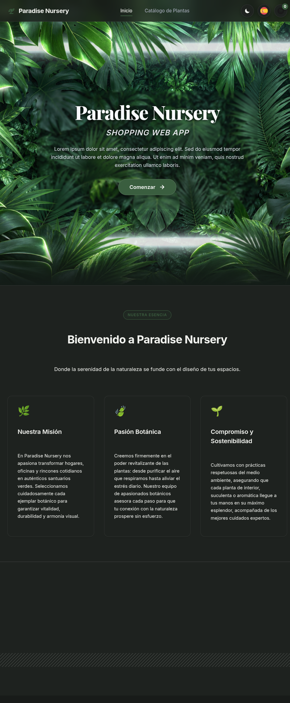
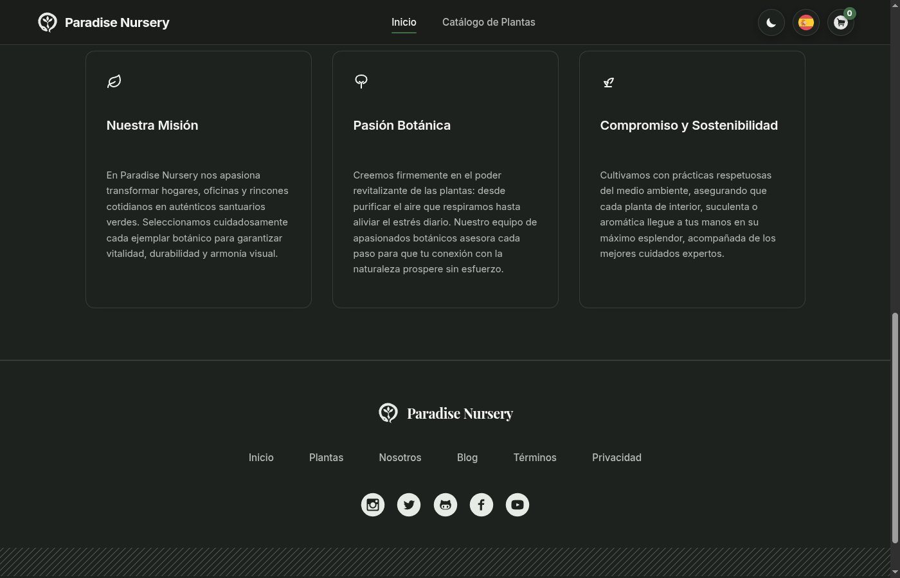
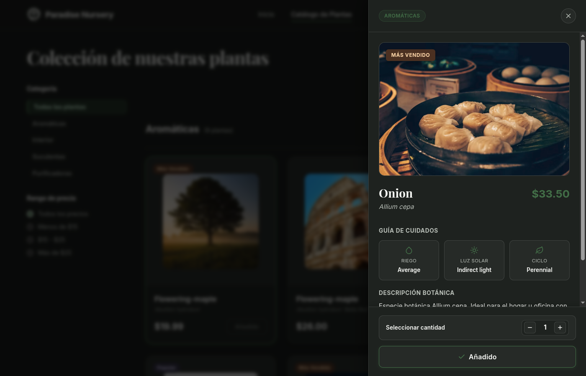
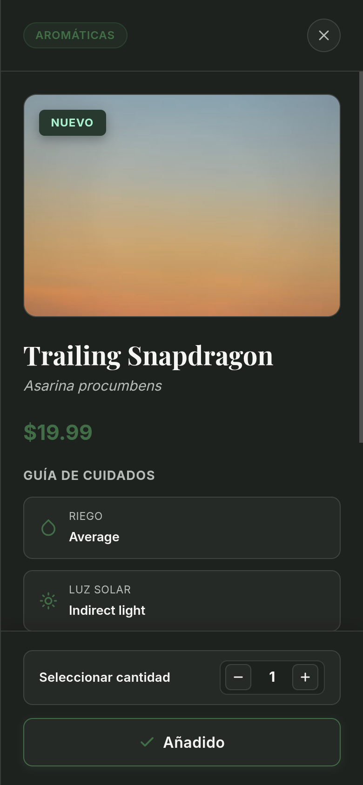
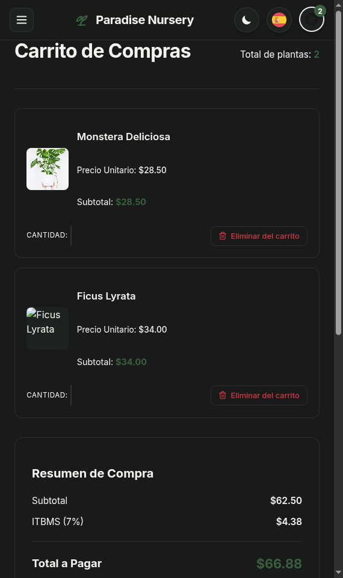
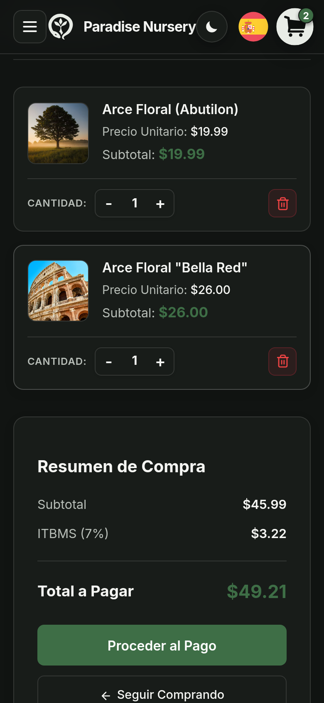
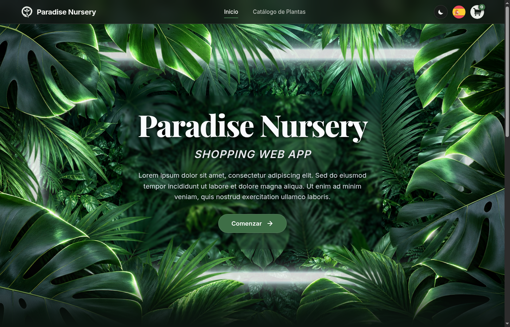
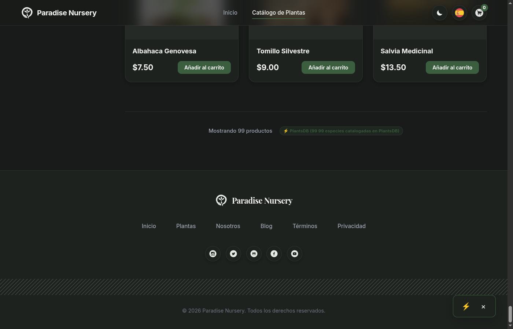

# 🌿 Paradise Nursery — Shopping Web Application

**IBM Full-Stack Software Developer & Frontend - React Capstone Project**

Paradise Nursery es una aplicación web de comercio electrónico botánico diseñada con un enfoque minimalista, sobrio y elegante. Permite a los usuarios explorar una cuidada colección de plantas de interior, consultar especificaciones de cuidados, gestionar su carrito en tiempo real con límites de stock dinámicos y completar un flujo de compra fluido y accesible tanto en dispositivos móviles como en escritorio.

---

## 🧭 Flujo de Usuario y Arquitectura de la Aplicación

### 1. Flujo de Navegación del Usuario


### 2. Ciclo de Datos y Gestión de Estado (Redux Toolkit)


---

## 📱 Galería Comparativa: Vista Desktop vs. Vista Mobile

A continuación se presentan las diferentes secciones y componentes del sitio web en sus versiones de escritorio y móvil, optimizadas para cada factor de forma:

### 1. Página de Inicio y Presentación (`Hero` & `About Us`)
| Vista Escritorio (Desktop) | Vista Móvil (Mobile) |
| :---: | :---: |
|  |  |
| *Hero con profundidad visual 3D, branding botánico y llamada a la acción.* | *Presentación de la misión, pasión botánica y compromiso ecológico.* |

---

### 2. Catálogo de Productos y Vista Detallada (`ProductList` & `PlantDetailDrawer`)
| Vista Escritorio: Catálogo y Drawer | Vista Móvil: Detalle y Selector de Cantidad |
| :---: | :---: |
|  |  |
| *Catálogo con filtro por categorías, indicador de unidades disponibles y botón sin redundancias.* | *Drawer adaptado a pantalla táctil con stepper de unidades y guía de riego/luz.* |

---

### 3. Carrito de Compras y Control de Unidades (`CartItem`)
| Vista Escritorio: Carrito y Resumen | Vista Móvil: Controles Táctiles y Eliminación |
| :---: | :---: |
|  |  |
| *Resumen de compra con subtotales por ítem, cálculo del ITBMS (7%) e integración de pago.* | *Fila de acciones espaciosa con botones táctiles grandes, límite de inventario y papelera compacta.* |

---

### 4. Sistema de Navegación y Pie de Página (`Navbar` & `Footer`)
| Barra de Navegación Uniforme | Pie de Página Botánico |
| :---: | :---: |
|  |  |
| *Botones uniformes de 38px: Switch de tema Skiper UI, cambio de idioma (ES/EN) y carrito con badge dinámico.* | *Redes sociales con íconos que ocupan el 100% del contenedor circular y animación hover.* |

---

## ✨ Características Principales

- **Colección Curada de 75 Especies:** Organizadas en 4 categorías botánicas (*Plantas de Interior*, *Purificadoras*, *Suculentas* y *Aromáticas*), superando ampliamente los requerimientos mínimos de la rúbrica.
- **Gestión de Stock y Logística de Inventario:** Cada producto cuenta con un stock controlado. Los selectores de cantidad impiden superar la disponibilidad máxima y se eliminan limpiamente al decrementar a cero.
- **Identificación Estricta por ID:** Prevención total de colisiones al añadir artículos al carrito; solo el ítem seleccionado cambia de estado.
- **Bilingüe y Adaptativo:** Soporte completo en español e inglés mediante `i18next`, y soporte nativo para modos Claro y Oscuro con variables CSS de alto contraste.
- **Diseño Responsivo:** Experiencia adaptada tanto a pantallas ultra anchas como a teléfonos móviles compactos (*iPhone / Android 390px*).

---

## 📋 Cumplimiento de Rúbrica y Entregables (Coursera / IBM)

Este repositorio está estructurado para cumplir con el **100% de la puntuación evaluada (50/50 puntos)**:

| Task | Archivo Evaluado | Pts | Requisitos Verificados |
|:---:|:---|:---:|:---|
| **Task 1** | [`README.md`](./README.md) | **2** | Documentación completa del proyecto, descripción, flujos visuales y guía. |
| **Task 2** | [`src/AboutUs.jsx`](./src/AboutUs.jsx) | **1** | Información institucional de Paradise Nursery, misión y sostenibilidad. |
| **Task 3** | [`src/App.css`](./src/App.css) | **1** | Implementación de `background-image: url('./assets/hero-background.png')`. |
| **Task 4** | [`src/App.jsx`](./src/App.jsx) | **3** | Nombre de la compañía, botón **Get Started**, navegación fluida y coordinación global. |
| **Task 5** | [`src/CartSlice.jsx`](./src/CartSlice.jsx) | **4** | Slice de Redux Toolkit con acciones `addItem`, `removeItem`, `updateQuantity` y `clearCart`. |
| **Task 6** | [`src/ProductList.jsx`](./src/ProductList.jsx) | **16** | 75 plantas en 4 categorías, thumbnails, nombres, precios, botón *Add to Cart* deshabilitado al añadir, y badge dinámico en navbar. |
| **Task 7** | [`src/CartItem.jsx`](./src/CartItem.jsx) | **23** | Total del carrito, subtotal por planta, controles `+` y `-` con límite de stock, botón rojo de eliminación, flujo de checkout y botón *Continuar Comprando*. |

---

## 🚀 Instalación y Puesta en Marcha

```bash
# 1. Clonar el repositorio
git clone https://github.com/tu-usuario/ParadiseNurseryShoppingApp.git
cd ParadiseNurseryShoppingApp

# 2. Instalar dependencias
npm install

# 3. Iniciar servidor de desarrollo
npm run dev

# 4. Compilar para producción y verificar linting
npm run lint
npm run build
```

---

## 📄 Licencia
Proyecto desarrollado con fines académicos y de certificación bajo el programa **IBM Frontend - React / Full-Stack Developer** en Coursera. Licencia MIT.
